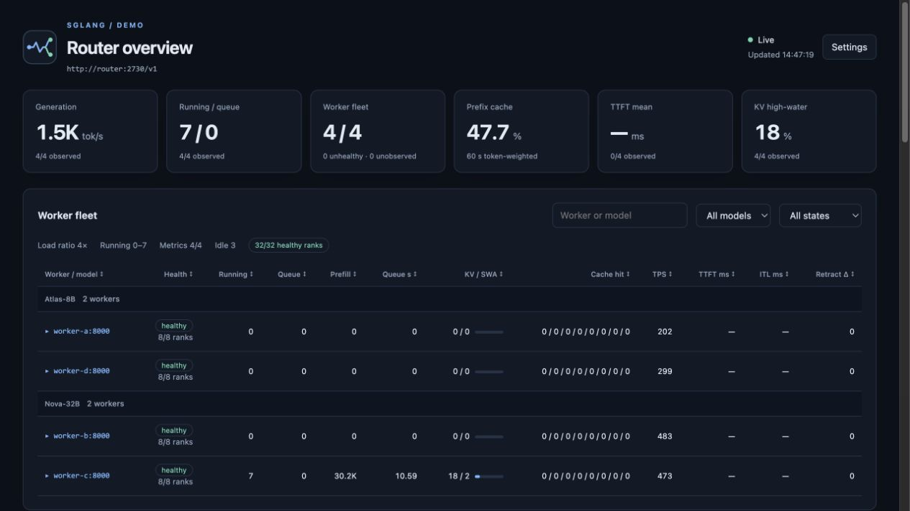
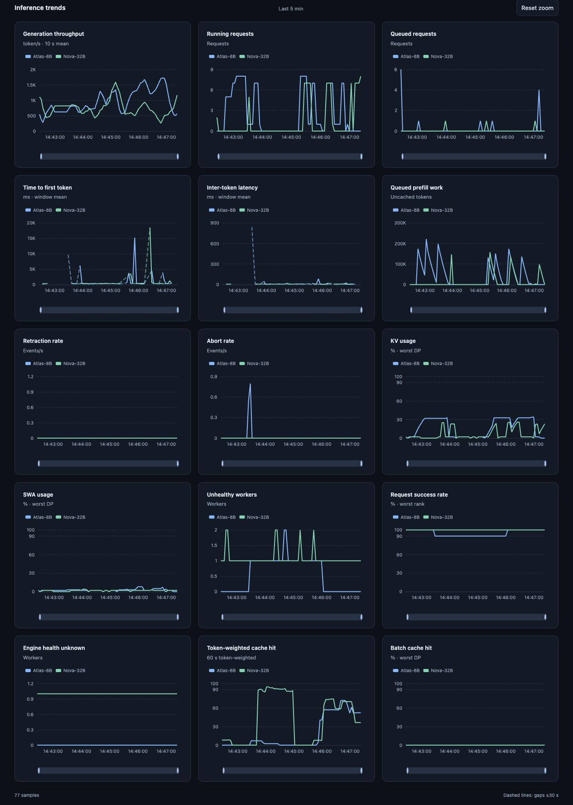

<p align="center"></p>

# LLM Router Monitor

English | [简体中文](https://github.com/wenxueru/llm-router-monitor/blob/main/README.zh-CN.md)

Monitor LLM Routers and inference workers. View inference metrics, rank details, and health by model.



## Install and run

Requires Python 3.10 or later.

```bash
python -m pip install llm-router-monitor
rmon http://127.0.0.1:4000
```

`llm-router-monitor` is an alias for `rmon`. Run `rmon --help` to list options. Open the dashboard at [localhost:8899](http://localhost:8899/).

| Option | Purpose |
| --- | --- |
| `--router-config FILE` | JSON configuration of named Routers |
| `--metrics-url URL` | Prometheus or NGINX `stub_status` endpoint |
| `--admin-url URL` | Separate admin endpoint |
| `--worker URL` | Add a worker. Repeat for multiple endpoints |
| `--router-type TYPE` | Override automatic detection |
| `--web-port PORT` | Dashboard port. Default `8899`. Use `0` for terminal only |
| `--interval SECONDS` | Collection interval. Default `2` |
| `--history-window MINUTES` | Initial chart window. Default `120` |

The dashboard binds to `0.0.0.0`. Set `ROUTER_API_KEY` for Router authentication and `WORKER_API_KEY` for worker authentication. The positional URL takes precedence over `--router-url` and `ROUTER_URL`.

## Multiple Routers

Save the Router configuration in `routers.local.json` using dashboard display names as keys.

```json
{
  "inference": {
    "endpoint": "http://router.example:2730",
    "router_type": "sglang",
    "interval": 2
  },
  "gateway": {
    "endpoint": "http://gateway.example:8080",
    "router_type": "nginx",
    "metrics_endpoint": "http://gateway.example:8080/stub_status",
    "worker_urls": ["http://engine.example:8000"]
  }
}
```

```bash
rmon --router-config routers.local.json --web-port 8899 --history-window 120
```

- Set an HTTP(S) `endpoint` for each target. Supply Router and worker credentials in `api_key` and `worker_api_key`. Other optional fields include `router_type`, `worker_urls`, `metrics_endpoint`, `admin_url`, and `interval`.
- Targets share the web port, initial history window, and Prometheus history configuration. Enable the web port for multiple Routers.
- Each target has its own collection loop. Select a target in the dashboard or pass `?router=NAME` to `/`, `/data`, or `/history`. The first target is the default.
- Maintenance defaults to off. Configure `keepalive`, `keepalive_unconditional`, `auto_unregister`, or `unregister_unavailable_after` per target. See [SGLang worker maintenance](#sglang-worker-maintenance).
- Git ignores `routers.local.json`.

## Supported Routers

Enable the Router's metrics endpoint or exporter for collection.

| Router | Discovery and metrics |
| --- | --- |
| SGLang | `/workers` provides registration, rank health, and load. Inference metrics come from workers |
| vLLM Production Stack | Worker discovery from Router metric labels |
| Standalone vLLM | Direct engine metrics |
| [LiteLLM](https://docs.litellm.ai/docs/proxy/prometheus) | `/model/info` and deployment metrics. Enable the Prometheus callback |
| NVIDIA Dynamo | Model deployments and frontend metrics |
| Envoy | Admin `/clusters?format=json` and upstream metrics |
| NGINX Plus | Upstreams exposed by the Prometheus exporter |
| Traefik | Upstreams exposed by enabled health checks |
| NGINX OSS | `stub_status` request totals or exporter metrics. Configure engines with `--worker` |
| HAProxy, Kong, Ray Serve | Proxy metrics. Configure engines with `--worker` |
| Other proxies | Configure SGLang/vLLM engines with `--worker` |

To measure request rates with `stub_status`, set `metrics_endpoint` in JSON or pass `--metrics-url` in single-Router mode. Use `worker_urls` or `--worker` to collect inference metrics from engines.

Monitor uses HTTP for host addresses discovered through Envoy and NGINX Plus. Use `--worker` to specify HTTPS addresses or custom paths.

Monitor Envoy through its separate admin port.

```bash
rmon http://127.0.0.1:8080 \
  --admin-url http://127.0.0.1:9901 \
  --metrics-url http://127.0.0.1:9901/stats/prometheus
```

Collect Router metrics from an exporter and specify worker addresses.

```bash
rmon http://127.0.0.1:8080 \
  --metrics-url http://127.0.0.1:9113/metrics \
  --worker http://worker-a:8000 --worker http://worker-b:8000
```

## Reading the dashboard

- Charts include models with observations in the selected window, including zeros. Zoom is synchronized across charts. Select a legend entry to toggle a model.
- TTFT and ITL charts connect valid observations. Other charts use dashed lines across missing intervals of up to 30 seconds. Lines break during collection outages or model unavailability.
- Select × to dismiss the current warning. It returns when the warning changes, the condition recurs, or the page reloads.

### Metrics and history

- TTFT and ITL means are weighted by observation counts from counter deltas. Cache hit rate is weighted by token counts over 60 seconds.
- If a worker model lookup fails, the dashboard uses the single known model name in its managed Router registrations. For missing or conflicting names, available metrics appear under “Unknown model”.
- History is stored in memory by default. Configure [Prometheus history](#prometheus-history) to query scraped samples across restarts.

### Dashboard settings

- **Display** controls the history window, refresh interval, language, and theme. The history window applies to the current page. The browser saves the other settings.
- **Keepalive** is editable on a local or port-forwarded dashboard. **Apply** updates the selected Router's running configuration. Monitor loads its startup configuration on restart.



| Endpoint | Response |
| --- | --- |
| `/data` | Router metadata, summaries, worker rows, and per-model metrics |
| `/history?n=100` | Samples with `at` (Unix seconds) and `by_model` |
| `/metrics` | Timestamped model metrics for all Router targets |

## Prometheus history

Assign each Monitor a separate Prometheus scrape job. `/metrics` provides model metrics with collection timestamps.

```yaml
scrape_configs:
  - job_name: router-monitor
    scrape_interval: 2s
    honor_timestamps: true
    static_configs:
      - targets: ["monitor.example:8899"]
```

Enable `honor_timestamps` and set the scrape interval to the shortest target collection interval or less.

```bash
rmon http://router.example:2730 \
  --history-prometheus-url http://prometheus.example:9090
```

| Option | Default | Purpose |
| --- | --- | --- |
| `--history-prometheus-url` | Unset | Prometheus base URL for history queries |
| `--history-prometheus-job` | `router-monitor` | Prometheus scrape job name |
| `--history-prometheus-lookback-hours` | `24` | Maximum history query window in hours |

These options require an enabled web port and apply to both single-Router and multi-Router configurations.

- `/history` merges Prometheus samples with recent local data. Prometheus retention controls how long scraped samples stay available. A failed history query returns `503`.
- Filter the metrics by `router` and `model` in Grafana or PromQL. For example, query `router_monitor_model_tps{job="router-monitor"}`.

## SGLang worker maintenance

### Keepalive

Keepalive is off by default. Choose a mode in the dashboard or at startup.

| Mode | Option | Scheduling |
| --- | --- | --- |
| Adaptive | `--keepalive` | Warm idle workers in rounds. Inference traffic cancels keepalive. Resume after five quiet seconds once workers are idle. |
| Unconditional | `--keepalive-unconditional` | Send requests to workers with a known model. Start a replacement after each success, including during inference traffic. |

```bash
rmon http://127.0.0.1:2730 --keepalive-unconditional
```

- Set `"keepalive": true` or `"keepalive_unconditional": true` on a named Router to select its mode.
- `--keepalive-concurrency` caps requests per worker. Three eligible workers with a limit of eight can run up to 24 concurrent keepalive requests.
- Monitor accepts and ignores the legacy `--keepalive-total-concurrency` option and `keepalive_total_concurrency` JSON field.
- Adaptive mode pauses when Router metrics are missing or worker observations are stale. Failed rounds use exponential backoff.
- The `keepalive` field in `/data` reports status, in-flight requests, dispatches, and cancellations.

| Option | Default | Purpose |
| --- | --- | --- |
| `--keepalive-concurrency` | `8` | Concurrent requests per worker |
| `--keepalive-interval` | `5` | Delay in seconds after an adaptive round or a failed unconditional request |
| `--keepalive-traffic-poll-interval` | `1` | Seconds between adaptive mode traffic polls |
| `--keepalive-max-interval` | `60` | Adaptive mode's maximum retry delay in seconds |
| `--keepalive-prompt-words` | `512` | Synthetic context word limit, with random lengths from one eighth to the limit |
| `--keepalive-min-tokens` | `0` | Minimum generated tokens, with `0` using the worker default |
| `--keepalive-max-tokens` | `64` | Generation budget limit. The random budget starts at one quarter of the limit, or the configured minimum if higher |

Random length and budget lower bounds round down and use a minimum of 1. Use `--keepalive-model` to target one model.

### Registration cleanup

- `--auto-unregister` compares the model reported by a worker with its registered model and removes mismatched registrations. It defaults to off.
- `--unregister-unavailable-after` sets the grace period. Monitor unregisters a worker when all ranks remain unhealthy and idle through the grace period and the final probe confirms unavailability. The single-Router default is `1800` seconds. Use `0` to disable this cleanup.
- Connection failures, connection or read timeouts, and remote protocol errors qualify as probe failures. Worker recovery, re-registration, or failed registry collection resets the timer.

Run `bash scripts/router.sh` with a compatible `sglang_router` runtime exposing `RouterArgs` to start a local SGLang Router. The default API port is `2730` and the metrics port is `29000`.

## Development

See [Architecture](docs/architecture.md) for module boundaries, data flow, and Router isolation.

Frontend tests require Node.js.

```bash
python -m pip install -e '.[dev]'
python -m unittest discover -s tests
ruff check .
ruff format --check router_monitor tests
python -m build
```

Build outputs are written to `dist/`. Install a wheel with `python -m pip install dist/llm_router_monitor-0.0.2-py3-none-any.whl`.
