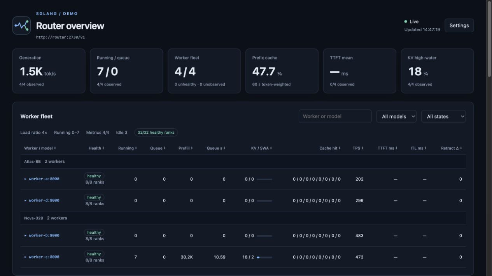
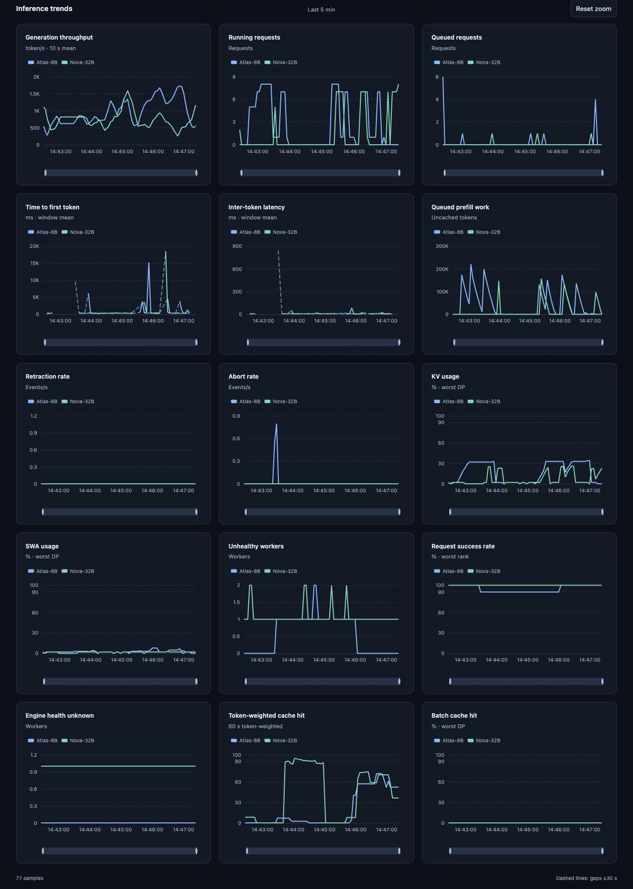

<p align="center"></p>

# Router Monitor

English | [简体中文](README.zh-CN.md)

A dashboard for LLM Routers and inference workers, with automatic Router detection and a bundled SGLang Router launcher.



## Start

Requires Python 3.10+ and network access to the Router's monitoring endpoints.

```bash
python -m pip install -e .
bash scripts/monitor.sh --router-url http://127.0.0.1:4000
```

Open [localhost:8899](http://localhost:8899/). Router type defaults to `auto`; the header shows the detected type and observed request rate.

For SGLang's default API/metrics ports (`2730`/`29000`):

```bash
bash scripts/monitor.sh --host 127.0.0.1
```

To start SGLang Router itself, install a compatible `sglang_router` runtime with the `RouterArgs` API, then run `bash scripts/router.sh`. Other Routers use their own launchers.

## Router support

Detection uses exposed registry and Prometheus interfaces. Metrics must be enabled in the Router or its exporter.

| Router | Discovery | Dashboard data |
| --- | --- | --- |
| [SGLang](https://github.com/sgl-project/sglang) | `/workers` | Worker/rank health, load, inference metrics; optional maintenance |
| [vLLM Production Stack](https://github.com/vllm-project/production-stack) | `server` labels in Router metrics | Worker discovery and direct vLLM engine metrics |
| [Direct vLLM](https://docs.vllm.ai/en/stable/usage/metrics/) | Engine metrics | One endpoint with per-engine metrics |
| [LiteLLM](https://docs.litellm.ai/docs/proxy/prometheus) | `/model/info` and deployment metric labels | Per-deployment output rate, TTFT, token cache hit, request success |
| [NVIDIA Dynamo](https://docs.nvidia.com/dynamo/dev/reference/observability/metrics-catalog) | Frontend `model` labels | Per-model output rate, TTFT, ITL |
| [Envoy](https://www.envoyproxy.io/docs/envoy/latest/operations/admin.html) | Admin `/clusters?format=json` | Upstream discovery, proxy traffic, direct worker metrics |
| [NGINX Plus](https://github.com/nginx/nginx-prometheus-exporter) | Exporter's upstream `server` labels | Upstream discovery, proxy traffic, direct worker metrics |
| [Traefik](https://doc.traefik.io/traefik/reference/install-configuration/observability/metrics/) | `traefik_service_server_up` when health checks are enabled | Upstream discovery, service traffic, direct worker metrics |
| [NGINX OSS](https://github.com/nginx/nginx-prometheus-exporter), [HAProxy](https://www.haproxy.com/documentation/haproxy-unified-gateway/administration/prometheus-metrics/haproxy-stats-metrics/), [Kong](https://developer.konghq.com/plugins/prometheus/), [Ray Serve](https://docs.ray.io/en/latest/serve/monitoring.html) | Explicit `--worker` endpoints | Proxy traffic and direct worker metrics |
| Unidentified proxy | Explicit `--worker` endpoints | Direct SGLang/vLLM worker metrics |

- Worker metrics are detected independently: SGLang and vLLM can sit behind any supported proxy.
- llm-d and other Kubernetes routing stacks can use their Envoy/admin and engine endpoints. Kubernetes resource discovery is not included.
- LiteLLM and Dynamo show **deployments**, not invented worker/rank counts. Adding `--worker` switches their fleet view to those explicit workers.
- Missing metrics remain unavailable. A proxy health check does not establish individual engine-rank health.
- Envoy socket addresses and NGINX Plus bare addresses are discovered as HTTP upstreams. Use explicit endpoints for different schemes or paths.
- Automatic detection needs a recognizable interface; use `--router-type` when interfaces are restricted or metrics are renamed.

### Connection examples

The quick-start command works with LiteLLM once its [Prometheus callback](https://docs.litellm.ai/docs/proxy/prometheus) is enabled. Set `ROUTER_API_KEY` in the environment if authentication is required.

Envoy with a separate admin listener:

```bash
bash scripts/monitor.sh --router-url http://127.0.0.1:8080 \
  --admin-url http://127.0.0.1:9901 \
  --metrics-url http://127.0.0.1:9901/stats/prometheus
```

A proxy with an exporter and explicit workers:

```bash
bash scripts/monitor.sh --router-url http://127.0.0.1:8080 \
  --metrics-url http://127.0.0.1:9113/metrics \
  --worker http://worker-a:8000 --worker http://worker-b:8000
```

## Configuration

```bash
bash scripts/monitor.sh --help
bash scripts/router.sh --help
```

Command-line options override environment variables and defaults.

| Monitor option | Default / purpose | Environment |
| --- | --- | --- |
| `--router-url` | Full Router base URL; overrides host/port | `ROUTER_URL` |
| `--router-type` | `auto` | — |
| `--metrics-url` | Explicit Prometheus URL; disables URL fallback | `METRICS_URL` |
| `--admin-url` | Router URL; separate Envoy admin listener | `ROUTER_ADMIN_URL` |
| `--worker` | Repeatable worker base URL | — |
| `--api-key` | Router/admin/metrics Bearer token | `ROUTER_API_KEY` |
| `--worker-api-key` | Separate worker Bearer token | `WORKER_API_KEY` |
| `--host` / `--port` | `127.0.0.1` / `2730` | `MASTER_HOST` / — |
| `--prom-port` | `29000`, separate SGLang metrics listener | `PROM_PORT` |
| `--interval` | `2` seconds | `INTERVAL` |
| `--history-window` | `5` minutes | — |
| `--web-port` | `8899`; `0` for terminal only | — |

- The dashboard listens on `0.0.0.0`.
- Without an explicit metrics URL, discovery tries the default metrics locations, including Envoy's admin path and SGLang's separate port.
- Router credentials are scoped to configured Router/admin/metrics origins; discovered workers use only the separate worker credential.
- LiteLLM collection reads passive endpoints. It does not invoke inference health probes or contact cloud provider URLs.
- Monitor aliases: `sglang-router-monitor` and `python -m router_monitor`. Shell entries use `python3`; set `PYTHON_BIN` for another interpreter.

## Dashboard

- Group endpoints by model; search, filter, sort, and expand engine details.
- Health reasons distinguish rank failures, upstream failures, slow computation, high request error rates, and suspected stalls.
- 15 single-metric trend charts, one line per model with consistent colors.
- Linked time zoom, legend selection, and actual-sample tooltips.
- Automatic updates; Settings groups the time window, refresh interval, English/Chinese language, and system/light/dark theme.
- Zoom and legend selections survive updates and language/theme changes.

One HTML contains Apache ECharts 6.1.0, CSS, JavaScript, LICENSE, and NOTICE. No runtime CDN requests. HTML-only updates require a browser refresh; backend updates require restarting the monitor.



### Measurements and API

- Collection is cached; page requests never trigger collection. History stays in memory for one hour.
- TTFT/ITL use count-weighted counter deltas. Token cache hit uses a 60-second token-weighted window.
- vLLM output rate uses generated-token deltas. Gateway output rates reflect tokens reported by the proxy.
- SGLang prefill requires complete DP coverage; rank health and success use the worst observed rank.
- LiteLLM success requires both request and failure counters; below 90% is labeled high request error rate when no engine health level is available.
- Missing signals, resets, and changed counter series stay missing. Dashed lines bridge metric gaps up to 30 seconds, never collection outages or unavailable models.

| Endpoint | Response |
| --- | --- |
| `/` | Dashboard |
| `/data` | Latest sample: Router metadata, `summary`, `worker_rows`, and per-model data |
| `/history?n=100` | Recent samples containing `at` (Unix seconds) and `by_model` metrics |

## SGLang worker maintenance

Policies apply only to SGLang Router registrations. Other Routers and explicitly added workers are read-only. Cleanup removes registrations, not worker processes.

| Option | Default | Action |
| --- | --- | --- |
| `--unregister-unavailable-after SECONDS` | `1800` | Remove persistently unhealthy, idle hosts after a failed connection probe |
| `--keepalive` | Off | Send short requests to observed idle workers |
| `--auto-unregister` | Off | Remove registrations whose actual model differs from the registered model |

- Cleanup requires all ranks explicitly unhealthy with zero registered load. A final `/v1/models` probe must fail to connect; HTTP responses and read timeouts retain the worker.
- Recovery, re-registration, or lost registry visibility resets the timer. Failed removals wait another grace period. Set `--unregister-unavailable-after 0` to disable.
- Keepalive requires observed zero Router/worker running and queued load. Defaults: 5-second rounds, up to 8 requests per idle worker, 64 output tokens, and prompts up to 512 words.
- Any keepalive failure backs off the round, up to 60 seconds. See `--help` for tuning options.

## Development

```text
router_monitor/                 Runtime package
  cli.py                        CLI and application lifecycle
  config.py / http.py           Configuration and HTTP transport
  sources.py                    Router discovery and metric dialects
  collectors.py / worker.py     Router and engine collection
  metrics.py / state.py         Metric calculations and shared history
  visualization.py / dashboard.py  View data, Web and terminal output
  templates/dashboard.html      Self-contained interface
  router.py                     SGLang Router launcher
scripts/                        Thin .sh entries
docs/images/                    Logo and anonymized previews
tests/                          Entry points, frontend, metrics and integration
```

```bash
python -m pip install -e '.[dev]'
python -m unittest discover -s tests -v
ruff check .
ruff format --check router_monitor tests
```

Tests use HTTP fixtures and Node.js with the bundled ECharts SVG renderer. Live compatibility depends on the installed Router version and enabled metric labels.
