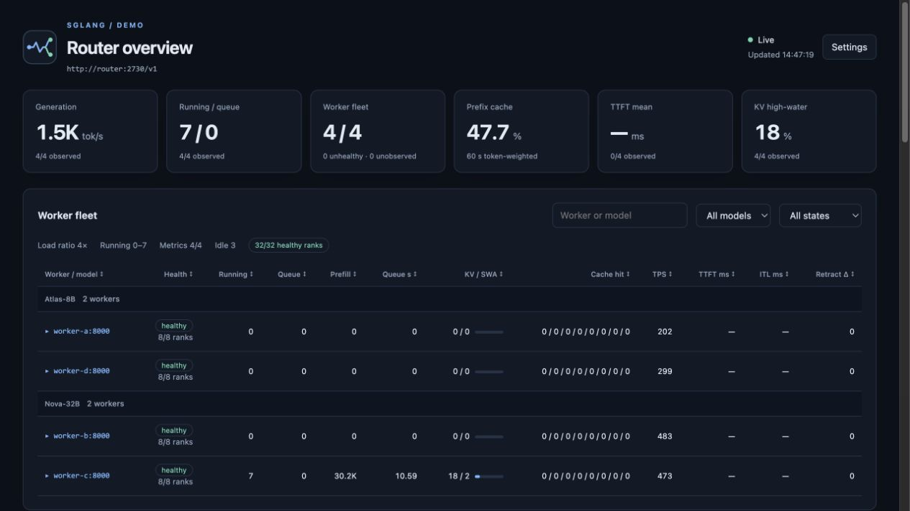

<p align="center"></p>

# LLM Router Monitor

[English](README.md) | 简体中文

监控 LLM Router 与推理 worker，按模型查看推理指标、rank 明细和健康状态。



## 安装与运行

需要 Python 3.10 或更高版本。

```bash
python -m pip install llm-router-monitor
rmon http://127.0.0.1:4000
```

访问 [localhost:8899](http://localhost:8899/)。`llm-router-monitor` 与 `rmon` 等价，完整参数见 `rmon --help`。

| 参数 | 用途 |
| --- | --- |
| `--router-config 文件` | 命名 Router 的 JSON 配置 |
| `--metrics-url URL` | Prometheus 或 NGINX `stub_status` 地址 |
| `--admin-url URL` | 独立管理接口地址 |
| `--worker URL` | 添加 worker，可重复传入 |
| `--router-type TYPE` | 手动指定 Router 类型 |
| `--web-port PORT` | 面板端口，默认 `8899`。设为 `0` 时仅显示终端界面 |
| `--interval 秒数` | 采集间隔，默认 `2` 秒 |
| `--history-window 分钟数` | 每次打开页面的初始窗口，默认 `120` 分钟（2 小时） |

面板监听 `0.0.0.0`。Router 认证使用 `ROUTER_API_KEY`，worker 认证使用 `WORKER_API_KEY`。位置参数 URL 优先于 `--router-url` 和 `ROUTER_URL`。

## 多 Router

将 Router 配置写入 `routers.local.json`，以面板上的显示名称为键。

```json
{
  "inference": {
    "endpoint": "http://router.example:2730",
    "router_type": "sglang",
    "interval": 2
  },
  "gateway": {
    "endpoint": "http://gateway.example:8080",
    "router_type": "nginx",
    "metrics_endpoint": "http://gateway.example:8080/stub_status",
    "worker_urls": ["http://engine.example:8000"]
  }
}
```

```bash
rmon --router-config routers.local.json --web-port 8899 --history-window 120
```

- 每个目标填写 HTTP(S) `endpoint`，用 `api_key` 和 `worker_api_key` 分别配置 Router 和 worker 的凭据。可选字段还包括 `router_type`、`worker_urls`、`metrics_endpoint`、`admin_url` 和 `interval`。
- 所有目标共享 Web 端口、初始历史窗口和 Prometheus 历史配置。多 Router 模式需要启用 Web 端口。
- 各目标独立采集。面板可切换目标，`/`、`/data` 和 `/history` 通过 `?router=名称` 指定目标，默认使用第一个。
- 默认关闭维护操作。按目标配置 `keepalive`、`keepalive_unconditional`、`auto_unregister` 或 `unregister_unavailable_after`。参数见 [SGLang worker 维护](#sglang-worker-维护)。
- `routers.local.json` 由 Git 忽略。

## 支持的 Router

开启 Router 指标接口或 exporter 以采集指标。

| Router | 发现方式与指标 |
| --- | --- |
| SGLang | `/workers` 提供注册、rank 健康和负载。推理指标从 worker 采集 |
| vLLM Production Stack | 从 Router 指标标签发现 worker |
| 独立 vLLM | 直接采集引擎指标 |
| [LiteLLM](https://docs.litellm.ai/docs/proxy/prometheus) | `/model/info` 和部署指标。开启 Prometheus callback |
| NVIDIA Dynamo | 模型部署与前端指标 |
| Envoy | 管理接口 `/clusters?format=json` 及上游指标 |
| NGINX Plus | Prometheus exporter 提供的上游信息 |
| Traefik | 健康检查提供的上游信息 |
| NGINX OSS | `stub_status` 请求计数或 exporter 指标。用 `--worker` 指定引擎 |
| HAProxy、Kong、Ray Serve | 代理指标。用 `--worker` 指定引擎 |
| 其他代理 | 通过 `--worker` 指定 SGLang/vLLM 引擎 |

使用 `stub_status` 统计请求速率时，在 JSON 中设置 `metrics_endpoint`，或在单 Router 模式传入 `--metrics-url`。用 `worker_urls` 或 `--worker` 配置推理指标的来源。

Monitor 通过 HTTP 访问 Envoy 和 NGINX Plus 发现的主机地址。用 `--worker` 指定 HTTPS 地址或自定义路径。

通过独立管理端口监控 Envoy。

```bash
rmon http://127.0.0.1:8080 \
  --admin-url http://127.0.0.1:9901 \
  --metrics-url http://127.0.0.1:9901/stats/prometheus
```

通过 exporter 采集 Router 指标，并指定 worker 地址。

```bash
rmon http://127.0.0.1:8080 \
  --metrics-url http://127.0.0.1:9113/metrics \
  --worker http://worker-a:8000 --worker http://worker-b:8000
```

## 查看面板

- 图表显示所选时间窗口内有观测的模型，包含零值。各图同步缩放，点击图例可切换模型的显示状态。
- TTFT 和 ITL 图连接有效观测点。其他图表以虚线连接 30 秒以内的缺测区间。采集中断或模型不可用时，线段在对应区间断开。
- 点击 × 收起当前提示。提示内容变化、异常再次发生或页面刷新时，提示重新显示。

### 指标与历史

- TTFT 和 ITL 均值按计数器增量中的观测次数加权。缓存命中率按 60 秒内的 token 数加权。
- worker 模型查询失败时，面板使用该主机受管注册记录中唯一明确的模型名。名称缺失或冲突时归入「未知模型」，并显示已采集的指标。
- 默认使用内存历史。跨重启查询已抓取的样本需配置 [Prometheus 持久历史](#prometheus-持久历史)。

### 面板设置

- **显示**可调整当前页面的历史窗口。浏览器保存此处设置的刷新频率、语言和主题。
- **保活**可在本机或通过端口转发修改。点击**应用**更新所选 Router 的运行配置。Monitor 重启时加载启动配置。


| 接口 | 内容 |
| --- | --- |
| `/data` | Router 信息、汇总、worker 明细与分模型指标 |
| `/history?n=100` | 包含 `at`（Unix 秒）和 `by_model` 的历史采样 |
| `/metrics` | 所有 Router 目标的带时间戳模型指标 |

## Prometheus 持久历史

为每个 Monitor 配置独立的 Prometheus 抓取任务。`/metrics` 提供带采集时间戳的模型指标。

```yaml
scrape_configs:
  - job_name: router-monitor
    scrape_interval: 2s
    honor_timestamps: true
    static_configs:
      - targets: ["monitor.example:8899"]
```

开启 `honor_timestamps`，并将抓取间隔设为各目标的最短采集间隔或更短。

```bash
rmon http://router.example:2730 \
  --history-prometheus-url http://prometheus.example:9090
```

| 参数 | 默认值 | 用途 |
| --- | --- | --- |
| `--history-prometheus-url` | 未设置 | Prometheus 基础地址，启用持久历史查询 |
| `--history-prometheus-job` | `router-monitor` | Prometheus 抓取任务名 |
| `--history-prometheus-lookback-hours` | `24` | 历史查询的最大时长，单位为小时 |

启用 Web 端口后，可在单 Router 和多 Router 模式下使用这些参数。

- `/history` 合并 Prometheus 样本与近期本地数据。Prometheus 的保留策略决定样本保存时间。查询失败时 `/history` 返回 `503`。
- 在 Grafana 或 PromQL 中按 `router` 和 `model` 标签筛选指标，例如 `router_monitor_model_tps{job="router-monitor"}`。

## SGLang worker 维护

### 保活

保活默认关闭。通过面板或启动参数选择模式。

| 模式 | 启动参数 | 调度行为 |
| --- | --- | --- |
| 自适应 | `--keepalive` | 按轮向空闲 worker 发保活。遇推理流量时取消，安静满 5 秒且 worker 空闲后恢复。 |
| 无条件 | `--keepalive-unconditional` | 向已识别模型的 worker 持续发保活。请求成功后立即补位，有推理流量时照常运行。 |

```bash
rmon http://127.0.0.1:2730 --keepalive-unconditional
```

- 命名 Router 可按目标设置 `"keepalive": true` 或 `"keepalive_unconditional": true`。
- `--keepalive-concurrency` 设置单 worker 上限。3 个符合条件的 worker 各设 8 时，并发上限为 24。
- Monitor 接受并忽略旧参数 `--keepalive-total-concurrency` 和 JSON 字段 `keepalive_total_concurrency`。
- 自适应模式在 Router 指标缺失或 worker 观测过期时暂停。失败后按轮指数退避。
- `/data` 的 `keepalive` 字段包含运行状态、在途数、发出数和取消数。

| 参数 | 默认值 | 用途 |
| --- | --- | --- |
| `--keepalive-concurrency` | `8` | 单 worker 并发上限 |
| `--keepalive-interval` | `5` | 自适应模式一轮结束后的等待时间，或无条件模式单请求失败后的重试间隔（秒） |
| `--keepalive-traffic-poll-interval` | `1` | 自适应模式检测推理流量的间隔，单位为秒 |
| `--keepalive-max-interval` | `60` | 自适应模式失败后的最大退避秒数 |
| `--keepalive-prompt-words` | `512` | 合成上下文词数上限，随机长度为上限的八分之一至上限 |
| `--keepalive-min-tokens` | `0` | 生成 token 下限，`0` 使用 worker 默认值 |
| `--keepalive-max-tokens` | `64` | 生成预算上限，随机预算的下界为上限四分之一与生成下限的较大值 |

随机长度和预算下界向下取整，且至少为 1。用 `--keepalive-model` 指定保活模型。

### 注册清理

- `--auto-unregister` 对照 worker 返回的实际模型和注册模型，注销不匹配的记录。默认关闭。
- `--unregister-unavailable-after` 设置不可用宽限期。所有 rank 持续不健康且空闲超过宽限期，并且复查判定主机不可用时，Monitor 注销注册记录。单 Router 模式默认 `1800` 秒，设为 `0` 关闭。
- 复查将连接失败、连接或读取超时、远端协议异常判定为不可用。worker 恢复、重新注册或注册表采集失败时，重新计算宽限期。

本地启动 SGLang Router 需要提供 `RouterArgs` 的兼容 `sglang_router`。运行 `bash scripts/router.sh`，API 默认端口为 `2730`，指标端口为 `29000`。

## 开发

模块职责、采集数据流和多 Router 隔离见[架构说明](docs/architecture.zh-CN.md)。

前端测试需要 Node.js。

```bash
python -m pip install -e '.[dev]'
python -m unittest discover -s tests
ruff check .
ruff format --check router_monitor tests
python -m build
```

构建产物位于 `dist/`，使用 `python -m pip install dist/llm_router_monitor-0.0.2-py3-none-any.whl` 安装 wheel。
