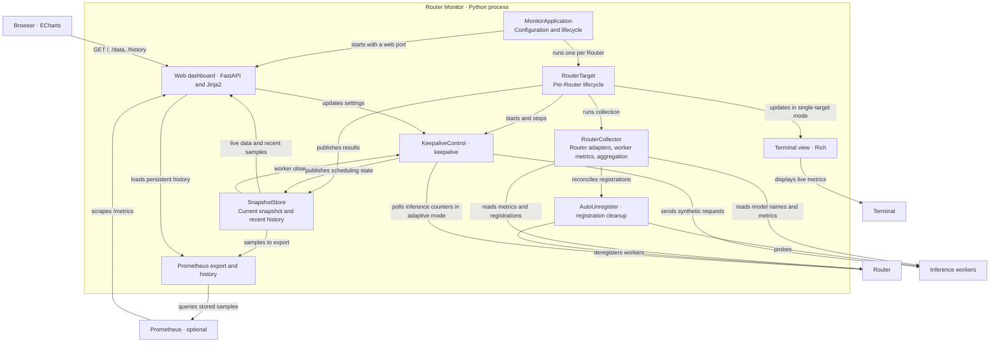

# Router Monitor architecture

[简体中文](architecture.zh-CN.md)

Monitor collects Router and worker metrics over HTTP. Each Router has its own configuration, credentials, collection loop, and state. Targets share the Monitor process, web port, and Prometheus history connection.

## Software architecture

## Module responsibilities

| Area | Code | Responsibility |
| --- | --- | --- |
| Entry and configuration | `cli.py`, `config.py`, `app.py` | Parse startup settings and run targets and interfaces. |
| Lifecycle and state | `target.py`, `state.py` | `RouterTarget` manages collection and keepalive for one target. `SnapshotStore` holds live data, recent samples, and keepalive status. |
| Collection | `collection/` | `RouterSource` reads metrics and registrations from each Router type. `WorkerMetricsCollector` reads worker models and metrics. `RouterCollector` aggregates the results. |
| Maintenance | `maintenance/` | `KeepaliveControl` applies settings and manages scheduling. `AutoUnregister` removes mismatched or persistently unavailable registrations. |
| Interfaces | `presentation/`, `templates/` | Serve the web, JSON, and terminal interfaces. Export Prometheus metrics and query history. |

## Runtime flows

1. Read Router metrics and registrations concurrently, then fetch worker models and inference metrics. The collector publishes worker details and per-model summaries to the target's `SnapshotStore`.
2. The browser polls `/data` and `/history` and selects a target with `router=NAME`. Single-target mode also updates the terminal.
3. Prometheus stores `/metrics` samples with their collection timestamps. Each export includes a collection marker and available metric values, including zeros. `/history` merges Prometheus and recent local samples by timestamp.
4. Adaptive keepalive polls inference counters independently and preserves its quiet period across settings updates. Model mismatch cleanup uses names reported directly by workers.

See [SGLang worker maintenance](../README.md#sglang-worker-maintenance) for modes and cleanup options.

Local and SSH-forwarded dashboards support writes. For a public dashboard, allow only `GET /settings/keepalive` at the reverse proxy.
