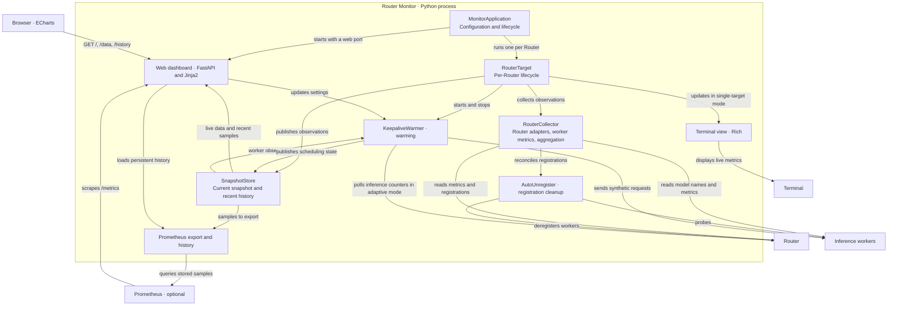

# Router Monitor architecture

[简体中文](architecture.zh-CN.md)

Router Monitor collects routing and inference metrics from one or more Routers. A single Python process hosts a shared web dashboard and runs an independent collection loop for each Router. A single-target launch can also display live metrics in the terminal.

## Software architecture

Each Router owns its configuration, credentials, collector, maintenance state, and sample store. Targets share one web port and Prometheus history connection. Router runs as a separate process, reached over HTTP.

## Module responsibilities

| Area | Code | Responsibility |
| --- | --- | --- |
| Entry and configuration | `cli.py`, `config.py`, `app.py` | Parse startup settings and run targets with the web dashboard or terminal. |
| Target lifecycle and state | `target.py`, `state.py` | Each `RouterTarget` runs a collector and keepalive controller against one `SnapshotStore`. |
| Collection | `collection/` | `RouterSource` owns Router reads. `WorkerMetricsCollector` reads models and metrics. `RouterCollector` combines discovery, traffic, and per-model summaries. |
| Maintenance | `maintenance/` | `KeepaliveControl` applies live settings and runs the warmer. `AutoUnregister` reconciles serving models and verifies unreachable registrations. |
| Presentation | `presentation/`, `templates/` | Serve the dashboard, JSON routes, and terminal. The Prometheus adapter exports stored samples and retrieves persisted history. |

## Runtime flows

1. **Collect.** Read Router metrics and registrations concurrently, then gather worker models and inference metrics. Aggregate worker details and per-model summaries once; publish the snapshot and timestamped sample to that target's store.
2. **Display.** The browser polls `/data` and `/history?n=N`, selecting a target through `router=NAME` (the first target by default). The initial window is 120 minutes. Single-target mode also updates the terminal.
3. **Retain history.** Prometheus scrapes `/metrics` with collection timestamps. `/history` merges stored observations with the local buffer. Export preserves zeros, omits missing metrics, and includes a collection marker. History-query failures return 503 without blocking live data.
4. **Maintain.** Adaptive keepalive polls inference counters independently and carries its quiet period across settings updates. Registration cleanup uses model names reported directly by workers.

See [SGLang worker maintenance](../README.md#sglang-worker-maintenance) for modes and cleanup options.

For public reverse-proxy deployments, expose `/settings/keepalive` as read-only at the proxy. Local and SSH-forwarded dashboards support writes.

## Design decisions

| Decision | Rationale and trade-off |
| --- | --- |
| Independent collection per Router, shared dashboard | A slow Router holds up its own collection cycle. CPU, memory, and the web server are shared by all targets in the process. |
| Normalize at the Router adapter | Backend-specific discovery stays in `RouterSource`. Aggregation and presentation use shared records, with detail determined by the metrics and discovery each backend exposes. |
| Use memory for live data and Prometheus for retention | A default launch has process-local history and needs no external store. Prometheus adds retention across restarts and defines the available history through its scrape interval and retention policy. |

For launch options and Router configuration, see the [README](../README.md).
