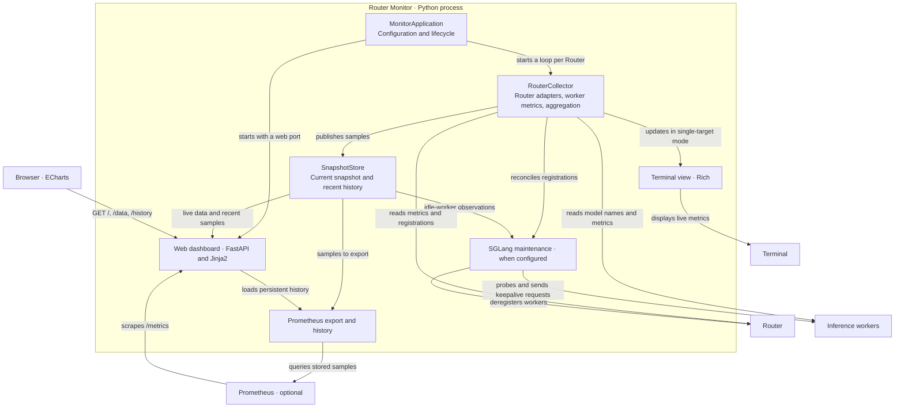

# Router Monitor architecture

[简体中文](architecture.zh-CN.md)

Router Monitor collects routing and inference metrics from one or more Routers. A single Python process hosts a shared web dashboard and runs an independent collection loop for each Router. A single-target launch can also display live metrics in the terminal.

## Software architecture

Each Router owns its configuration, credentials, collector, maintenance state, and sample store. Targets share one web port and Prometheus history connection. Router runs as a separate process, reached over HTTP.

## Module responsibilities

| Area | Code | Responsibility |
| --- | --- | --- |
| Composition | `cli.py`, `config.py`, `app.py` | Parse configuration with Typer and Pydantic. `MonitorApplication` assembles targets and manages their lifecycles. |
| Collection | `collectors.py`, `sources.py`, `http.py`, `worker.py` | `RouterCollector` coordinates `RouterSource` and `WorkerMetricsCollector`. Router adapters normalize registrations and metrics. HTTP clients reuse connections and scope credentials. |
| Aggregation and state | `metrics.py`, `visualization.py`, `state.py` | Compute rates, latency, and per-model summaries. Each `RouterTarget` pairs configuration with a `SnapshotStore`. |
| Presentation | `dashboard.py`, `templates/dashboard.html`, `terminal.py` | Serve a Jinja2 page and JSON data through FastAPI, plot trends with ECharts, and display live tables with Rich. |
| Persistent history | `history.py` | Export timestamped samples and read historical observations from Prometheus. |
| Maintenance | `maintenance.py` | `KeepaliveWarmer` sends synthetic traffic to idle workers. `AutoUnregister` applies SGLang registration cleanup rules. |

## Runtime flows

1. **Collect.** Read Router metrics and registrations concurrently, then gather worker models and inference metrics. Aggregate worker details and per-model summaries once; publish the snapshot and timestamped sample to that target's store.
2. **Display.** The browser polls `/data` and `/history?n=N`, selecting a target through `router=NAME` (the first target by default). The initial window is 120 minutes. Single-target mode also updates the terminal.
3. **Retain history.** Prometheus scrapes `/metrics` with collection timestamps. `/history` merges stored observations with the local buffer. Export preserves zeros, omits missing metrics, and includes a collection marker. History-query failures return 503 without blocking live data.
4. **Maintain.** Per-target policies perform keepalive and SGLang registration cleanup. Keepalive needs observed idle load and an identified model. Unavailable-host cleanup waits for every managed rank to remain unhealthy and idle through the grace period, then probes again. Model-mismatch cleanup requires successful worker discovery; registration-name fallback is only for metric attribution.

## Design decisions

| Decision | Rationale and trade-off |
| --- | --- |
| Independent collection per Router, shared dashboard | A slow Router holds up its own collection cycle. CPU, memory, and the web server are shared by all targets in the process. |
| Normalize at the Router adapter | Backend-specific discovery stays in `RouterSource`. Aggregation and presentation use shared records, with detail determined by the metrics and discovery each backend exposes. |
| Use memory for live data and Prometheus for retention | A default launch has process-local history and needs no external store. Prometheus adds retention across restarts and defines the available history through its scrape interval and retention policy. |

For launch options and Router configuration, see the [README](../README.md).
