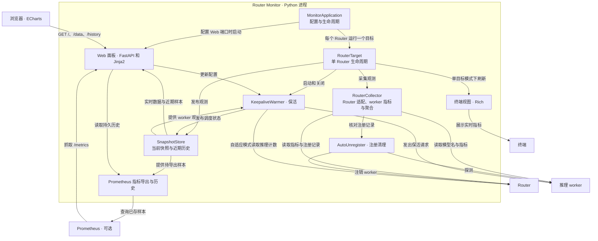

# Router Monitor 架构

[English](architecture.md)

Router Monitor 采集一个或多个 Router 的路由和推理指标。一个 Python 进程提供共享的 Web 面板，并为每个 Router 运行独立的采集循环。监控单个 Router 时也可在终端查看实时指标。

## 软件架构

每个 Router 拥有独立的配置、凭据、采集器、维护状态和样本存储。各目标共享 Web 端口和 Prometheus 历史连接。Router 是独立进程，Monitor 通过 HTTP 访问。

## 模块职责

| 模块 | 代码 | 职责 |
| --- | --- | --- |
| 入口和配置 | `cli.py`、`config.py`、`app.py` | 解析启动配置，运行各 Router 目标及 Web 或终端界面。 |
| 目标生命周期与状态 | `target.py`、`state.py` | 每个 `RouterTarget` 负责采集和保活，两者共用一个 `SnapshotStore`。 |
| 采集 | `collection/` | `RouterSource` 读取 Router，`WorkerMetricsCollector` 读取模型与指标，`RouterCollector` 汇总注册记录、流量和模型指标。 |
| 维护 | `maintenance/` | `KeepaliveControl` 热更新配置并管理保活任务。`AutoUnregister` 核对实际模型，复查持续不可用的注册。 |
| 展示 | `presentation/`、`templates/` | 提供面板、JSON 路由和终端界面。Prometheus 适配器导出样本并查询持久历史。 |

## 运行流程

1. **采集。** 并行读取 Router 指标和注册记录，再获取 worker 模型和推理指标。统一计算 worker 明细与模型汇总，将快照和带时间戳的样本发布到对应目标的存储。
2. **展示。** 浏览器轮询 `/data` 和 `/history?n=N`，通过 `router=NAME` 选择目标，默认使用第一个。初始窗口为 120 分钟，单目标模式同时刷新终端。
3. **保留历史。** Prometheus 抓取 `/metrics` 并保留采集时间戳，`/history` 合并已存观测与本地缓冲。导出保留零值、跳过缺失指标，并包含采集标记。历史查询失败返回 503，实时数据继续可用。
4. **维护。** 自适应保活单独轮询推理计数，热更新时延续当前静默期。注册清理使用 worker 直接报告的模型名。

保活模式和注册清理参数见 [SGLang worker 维护](../README.zh-CN.md#sglang-worker-维护)。

通过反向代理公开面板时，在代理层将 `/settings/keepalive` 设为只读。本机和 SSH 转发入口可修改设置。

## 架构决策

| 决策 | 理由与取舍 |
| --- | --- |
| 独立采集，共享面板 | 单个 Router 响应慢时，延迟发生在该 Router 的采集循环。所有目标共用进程的 CPU、内存和 Web 服务。 |
| 在 Router 适配层统一数据结构 | 后端特有的发现逻辑集中在 `RouterSource`。聚合与展示复用同一套数据结构，能呈现的细节取决于各后端提供的指标和发现能力。 |
| 内存提供实时数据，Prometheus 保留长期历史 | 默认启动只需 Monitor 进程，历史随进程生命周期保存。Prometheus 支持跨重启保留历史，历史覆盖范围和采样密度受保留策略及抓取间隔影响。 |

启动方式和 Router 配置见 [README](../README.zh-CN.md)。
