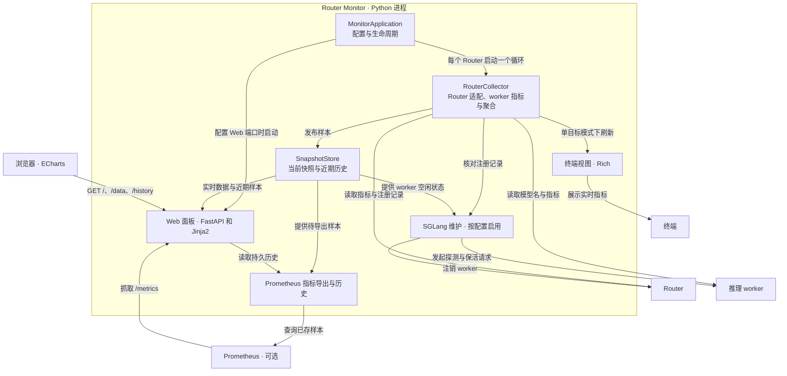

# Router Monitor 架构

[English](architecture.md)

Router Monitor 采集一个或多个 Router 的路由和推理指标。一个 Python 进程提供共享的 Web 面板，并为每个 Router 运行独立的采集循环。监控单个 Router 时也可在终端查看实时指标。

## 软件架构

每个 Router 拥有独立的配置、凭据、采集器、维护状态和样本存储。各目标共享 Web 端口和 Prometheus 历史连接。Router 是独立进程，Monitor 通过 HTTP 访问。

## 模块职责

| 模块 | 代码 | 职责 |
| --- | --- | --- |
| 应用组装 | `cli.py`、`config.py`、`app.py` | Typer 和 Pydantic 解析配置，`MonitorApplication` 组装目标并管理生命周期。 |
| 数据采集 | `collectors.py`、`sources.py`、`http.py`、`worker.py` | `RouterCollector` 协调 `RouterSource` 和 `WorkerMetricsCollector`。Router 适配器统一注册记录和指标结构。HTTP 客户端复用连接并按来源使用凭据。 |
| 指标聚合与状态 | `metrics.py`、`visualization.py`、`state.py` | 计算速率、延迟和按模型汇总的指标。每个 `RouterTarget` 持有配置和一个 `SnapshotStore`。 |
| 展示 | `dashboard.py`、`templates/dashboard.html`、`terminal.py` | FastAPI 提供 Jinja2 页面和 JSON 数据，ECharts 渲染趋势，Rich 展示终端实时表格。 |
| 持久历史 | `history.py` | 导出带时间戳的样本，从 Prometheus 读取历史观测。 |
| 维护 | `maintenance.py` | `KeepaliveWarmer` 向空闲 worker 发送合成请求，`AutoUnregister` 执行 SGLang 注册清理规则。 |

## 运行流程

1. **采集。** 并行读取 Router 指标和注册记录，再获取 worker 模型和推理指标。统一计算 worker 明细与模型汇总，将快照和带时间戳的样本发布到对应目标的存储。
2. **展示。** 浏览器轮询 `/data` 和 `/history?n=N`，通过 `router=NAME` 选择目标，默认使用第一个。初始窗口为 120 分钟，单目标模式同时刷新终端。
3. **保留历史。** Prometheus 抓取 `/metrics` 并保留采集时间戳，`/history` 合并已存观测与本地缓冲。导出保留零值、跳过缺失指标，并包含采集标记。历史查询失败返回 503，实时数据继续可用。
4. **维护。** 各目标分别执行保活和 SGLang 注册清理策略。保活需要已观测的空闲状态和已识别模型。不可用清理等待所有受管 rank 在宽限期内持续不健康且空闲，再次探测后才注销。模型不匹配清理要求 worker 查询成功；注册名回退仅用于指标归类。

## 架构决策

| 决策 | 理由与取舍 |
| --- | --- |
| 独立采集，共享面板 | 单个 Router 响应慢时，延迟发生在该 Router 的采集循环。所有目标共用进程的 CPU、内存和 Web 服务。 |
| 在 Router 适配层统一数据结构 | 后端特有的发现逻辑集中在 `RouterSource`。聚合与展示复用同一套数据结构，能呈现的细节取决于各后端提供的指标和发现能力。 |
| 内存提供实时数据，Prometheus 保留长期历史 | 默认启动只需 Monitor 进程，历史随进程生命周期保存。Prometheus 支持跨重启保留历史，历史覆盖范围和采样密度受保留策略及抓取间隔影响。 |

启动方式和 Router 配置见 [README](../README.zh-CN.md)。
