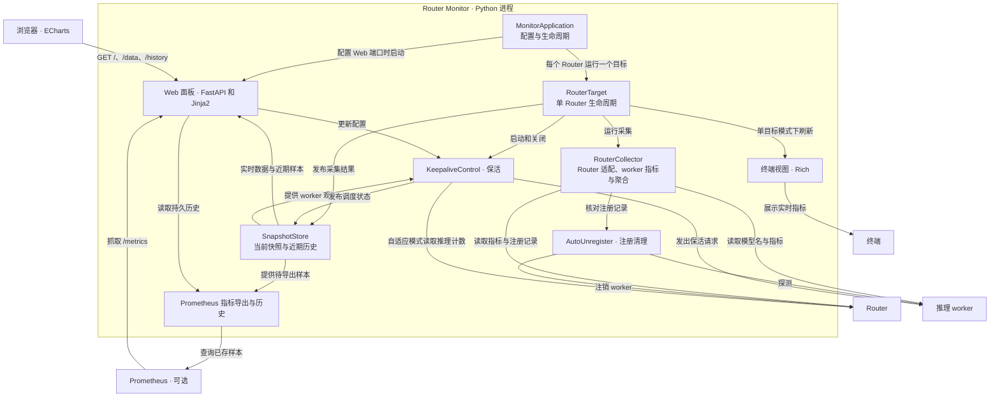

# Router Monitor 架构

[English](architecture.md)

Monitor 通过 HTTP 采集 Router 和 worker 的指标。每个 Router 有独立的配置、凭据、采集循环和状态。各目标共享一个 Monitor 进程、Web 端口和 Prometheus 历史连接。

## 软件架构

## 模块职责

| 模块 | 代码 | 职责 |
| --- | --- | --- |
| 入口和配置 | `cli.py`、`config.py`、`app.py` | 解析启动配置，启动各目标和界面。 |
| 生命周期与状态 | `target.py`、`state.py` | `RouterTarget` 管理单个目标的采集和保活。`SnapshotStore` 保存实时状态、近期样本和保活状态。 |
| 采集 | `collection/` | `RouterSource` 适配各类 Router 的指标和注册记录。`WorkerMetricsCollector` 查询 worker 的模型和指标。`RouterCollector` 汇总结果。 |
| 维护 | `maintenance/` | `KeepaliveControl` 应用配置并管理保活调度。`AutoUnregister` 清理模型不匹配或持续不可用的注册记录。 |
| 接口与展示 | `presentation/`、`templates/` | 提供 Web、JSON 和终端界面，导出 Prometheus 指标并查询历史。 |

## 运行流程

1. 并行读取 Router 指标和注册记录，再读取 worker 模型和推理指标。采集器生成 worker 明细及模型汇总，按目标发布到 `SnapshotStore`。
2. 浏览器轮询 `/data` 和 `/history`，用 `router=NAME` 选择目标。单目标模式同时更新终端。
3. Prometheus 用采集时间戳保存 `/metrics` 的样本。导出包含采集标记和已有的指标值，包括零值。`/history` 按时间合并 Prometheus 样本和近期本地数据。
4. 自适应保活单独轮询推理计数，热更新时延续静默期。模型不匹配清理使用 worker 直接报告的模型名。

保活模式和注册清理参数见 [SGLang worker 维护](../README.zh-CN.md#sglang-worker-维护)。

本机和 SSH 转发入口可以修改设置。公开面板时，在反向代理仅放行 `GET /settings/keepalive`。
